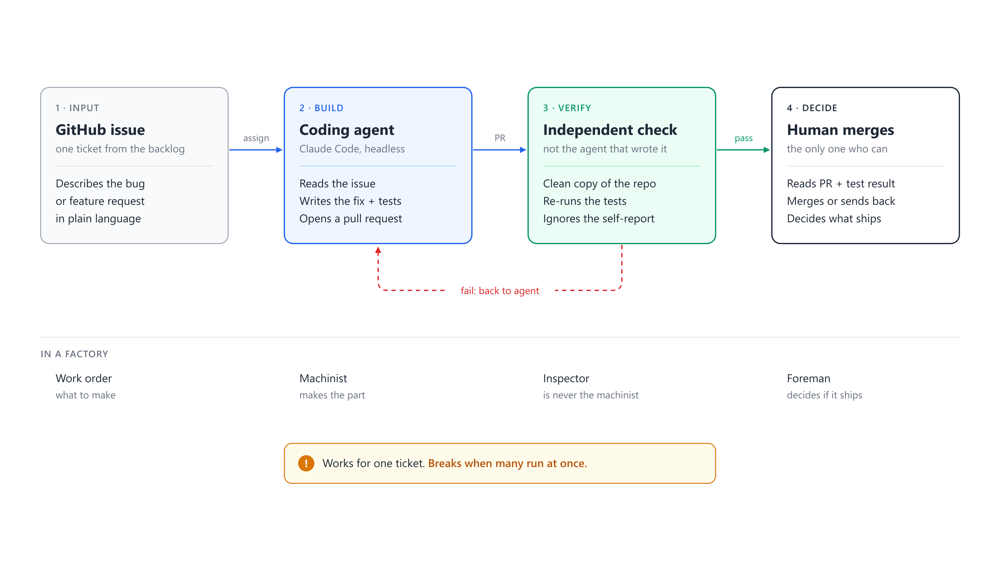
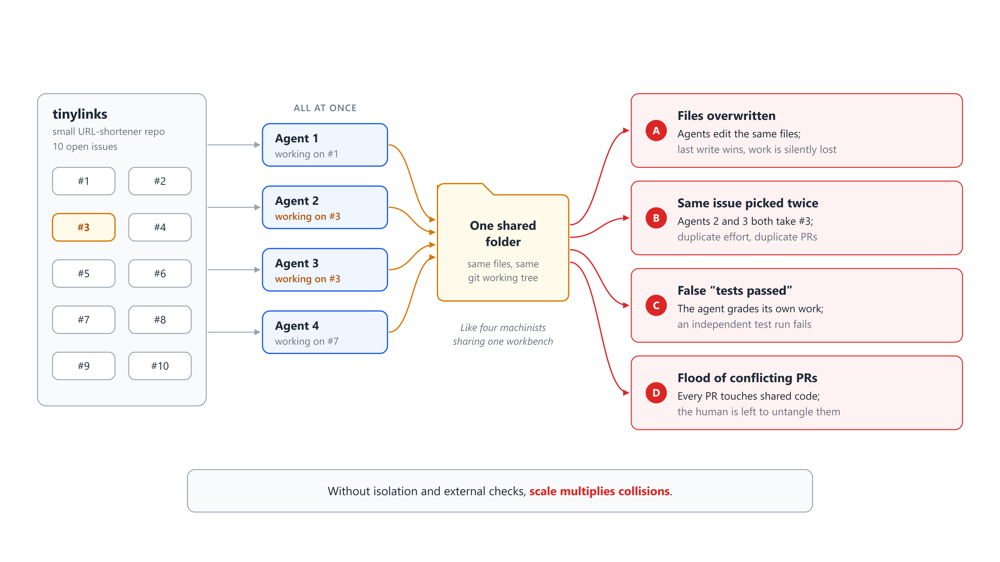
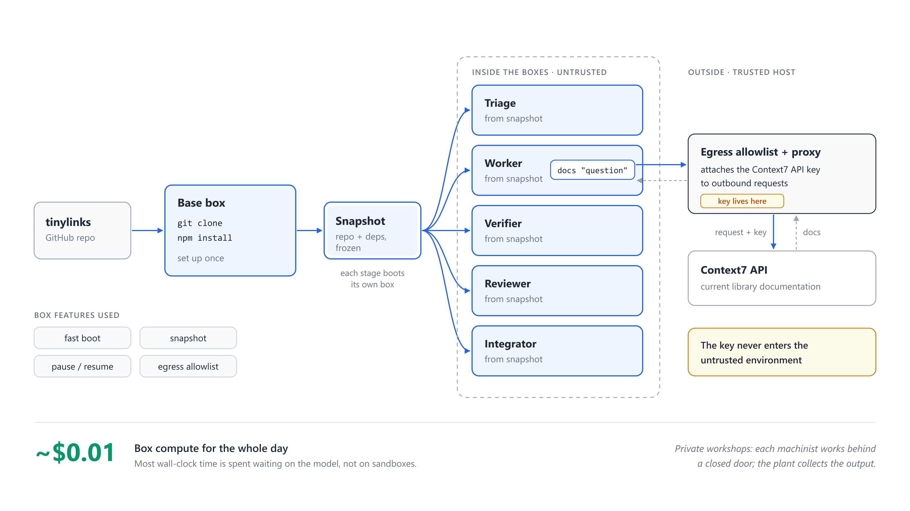
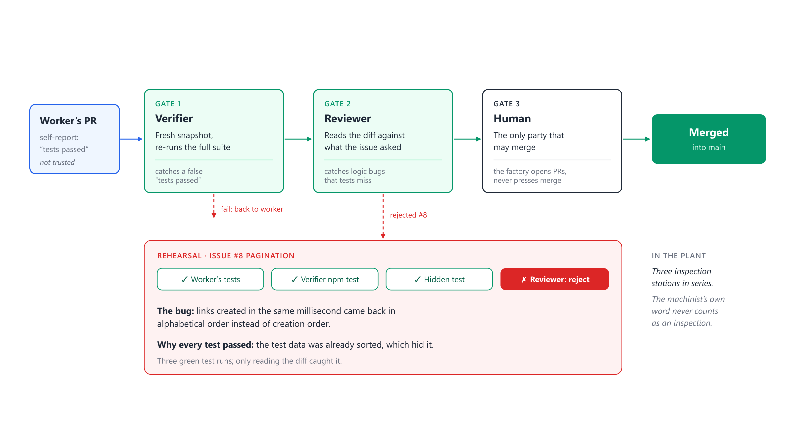
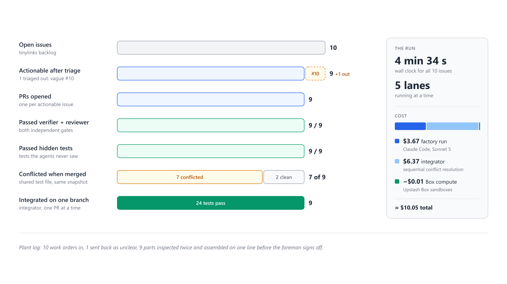

# Software Factory from Scratch

**GitHub issues in, verified and reviewed pull requests out. A human merges.**

A complete software factory built only from [Claude Code](https://code.claude.com) **skills**: one human-triggered workflow skill (`/software-factory`) drives a small deterministic runner, and every stage of the line (triage, worker, verifier, reviewer, integrator) is a skill that becomes the contract for one headless agent working in its own sandbox. It ships with a **12-lab codelab** for students: a practice app, ten issues, hidden tests, sample ledgers and an instructor guide.

[](https://github.com/dlmastery/software-factory-from-scratch/actions/workflows/ci.yml)


Based on the video [**Build a Self-Improving Software Factory**](https://youtu.be/hO4ft4tGOJI) (Prompt Engineering) and its MIT-licensed reference implementation [PromtEngineer/software-factory](https://github.com/PromtEngineer/software-factory), which runs each stage in an [Upstash Box](https://upstash.com/box). This repository re-builds the same factory as portable skills that run on a laptop, in CI, or on any sandbox backend.

---

## The story in eight frames

Think of the factory as a manufacturing plant for code. Raw work (issues) goes in; verified, merge-ready pull requests come out.

### 1. The core loop



The simplest useful factory is a four-step loop. An issue arrives. One coding agent (Claude Code, headless) reads it, writes the fix and tests, and opens a pull request. A separate process re-runs the tests on a clean copy. Only a human may merge. A machinist finishes the part, an inspector who is not the machinist checks it, and the foreman decides whether it ships. This works for one ticket. It breaks when many run at once.

### 2. What breaks when agents run in parallel



Parallel agents in one shared folder fail in four predictable ways: they overwrite each other's files, two of them take the same issue, an agent reports "tests passed" when an independent run fails, and the human is left with a flood of conflicting pull requests. Without isolation and external checks, scale multiplies collisions. Lab 2 of the codelab reproduces this on demand (`--sandbox shared`).

### 3. Five structural fixes


A sandbox per agent, a claim label on the issue, a separate verifier and reviewer, live documentation, and an integrator followed by a human merge. These are process constraints, not prompt tricks: each one removes a failure mode by construction, so the factory does not depend on an agent behaving well.

### 4. The staged pipeline


Each stage runs in a fresh sandbox and hands the next stage a small, typed JSON object rather than a chat transcript. Triage rejects what cannot be built (in the demo, one deliberately vague issue). The worker writes the code and tests. The verifier re-runs the whole suite on a clean copy and ignores the worker's self-report. The reviewer reads the diff for logic errors tests miss. The integrator merges approved branches one by one and re-tests. A human merges.

### 5. Isolation, and keys outside the box



One base sandbox clones the repo and installs dependencies once; every stage boots its own copy of that snapshot. In the video each copy is an Upstash Box (fast boot, snapshots, pause/resume, egress allowlist), and the Context7 key is attached to outbound requests **outside** the box, so the agent never holds it. Box compute for the whole day was about $0.01: agents spend their time waiting on the model. This repository reproduces the same properties locally (a snapshot copy per stage, a key-holding docs proxy) and documents the cloud and container backends.

### 6. Independent quality gates



Agents do sometimes claim tests passed when an independent run shows failures, so the verifier always starts from a clean snapshot. Unit tests are not enough either: in the video's rehearsal the reviewer rejected a pagination change that passed the worker's tests, the verifier and the hidden test. Links created in the same millisecond came back in alphabetical order, and the sorted test data hid it. The factory opens pull requests; it never presses merge.

### 7. The measured run



On the video's demo repository: 10 issues in 4 minutes 34 seconds with 5 lanes. Triage rejected the vague one. Nine pull requests passed the verifier and the reviewer, and all nine passed hidden tests the agents never saw. Seven of the nine still conflicted when merged together, because workers edited the same test file from identical snapshots; the integrator resolved them sequentially. Model cost: $3.67 for the run, $6.37 for integration. [This repository's own measured run](#measured-run-of-this-repository) is below.

### 8. Lessons, and the outer loop


A factory pays off on a high-volume backlog, not a single fix. Quality is still a function of the test suite and the reviewer's attention; autonomy does not replace those gates. A fresh sandbox per stage plus human-only merges keeps it auditable. And the traces every run leaves feed an outer loop that improves skills, prompts and routing rules, which is what makes the factory self-improving. The essential pattern is the constrained loop, **issue -> isolated agent -> independent check -> human merge**, whatever the model or sandbox vendor.

---

## Quick start

Requirements: Node 22+, git, [Claude Code](https://code.claude.com) (for real runs), and the [GitHub CLI](https://cli.github.com) for GitHub repositories.

```bash
cd ~
git clone https://github.com/dlmastery/software-factory-from-scratch
cd software-factory-from-scratch
npm test                                   # unit tests + two fake-agent end-to-end runs, no model needed

# A practice repository with 10 issues, entirely local:
node codelab/scripts/seed.mjs local ~/factory-lab
cd ~/factory-lab
SF=~/software-factory-from-scratch/skills/software-factory/scripts/factory.mjs
node $SF doctor
node $SF run --yes --agent fake            # zero-cost dry run: watch the whole line work
node $SF release --issues 1,2,3,4,5,6,7,8,9,10
node $SF run --agent claude --issues 3,8,10   # real agents; shows the budget ceiling and asks first
```

Then, from Claude Code in any repository with a `factory.config.json`:

```
/software-factory plan
/software-factory run --issues 12,15,18
```

## Install the skills

**As a Claude Code plugin** (skills are namespaced, e.g. `/software-factory:software-factory`):

```
/plugin marketplace add dlmastery/software-factory-from-scratch
/plugin install software-factory@software-factory-from-scratch
```

**As plain skills** (short names, e.g. `/software-factory`):

```bash
node scripts/install-skills.mjs            # ~/.claude/skills, for all your projects
cd <your-repo> && node ~/software-factory-from-scratch/scripts/install-skills.mjs --project   # <your-repo>/.claude/skills, commit to share
```

Install all skills together: the runner finds the stage skills and schemas next to itself.

## The skills

| Skill | Role | Invoked by |
|---|---|---|
| [`software-factory`](skills/software-factory/SKILL.md) | **Workflow.** Config, preflight, plan, explicit go-ahead with the budget ceiling, run, report, hand-over. Contains the runner and the schemas | **Humans only** (`disable-model-invocation: true`) |
| [`factory-triage`](skills/factory-triage/SKILL.md) | Is the issue concrete and testable? Produces acceptance criteria | the runner; or a human ("triage these issues") |
| [`factory-worker`](skills/factory-worker/SKILL.md) | Resolves exactly one issue with tests, in its own sandbox | the runner |
| [`factory-verifier`](skills/factory-verifier/SKILL.md) | The clean-copy test gate (runner code) + `verify-branch.mjs` for humans | the runner; humans |
| [`factory-reviewer`](skills/factory-reviewer/SKILL.md) | Independent, read-only review hunting for what tests miss | the runner; humans (`/factory-reviewer`) |
| [`factory-integrator`](skills/factory-integrator/SKILL.md) | Resolves merge conflicts, keeping both sides and all tests | the runner |
| [`factory-claims`](skills/factory-claims/SKILL.md) | Claim labels and claim directories; release and diagnose skips | humans |
| [`factory-sandbox`](skills/factory-sandbox/SKILL.md) | Isolation model; [Upstash Box](skills/factory-sandbox/references/upstash-box.md) and [container](skills/factory-sandbox/references/containers.md) backend guides | humans |
| [`factory-live-docs`](skills/factory-live-docs/SKILL.md) | Context7 grounding through a key-holding proxy | stage agents (`--grounding`) |
| [`factory-report`](skills/factory-report/SKILL.md) | Reads ledgers; explains outcomes, costs and next actions | humans |
| [`factory-improve`](skills/factory-improve/SKILL.md) | **Outer loop.** Mines traces, proposes measured, human-approved improvements | humans |

## How it works

```
                 +-------------------- one lane per issue (concurrency N) --------------------+
 issues --claim--> triage box --> worker box --push--> verifier box: tests x2 --> reviewer --> PR --> human merge
   (label /        {actionable,    {status, summary,     (fresh copy of the     {verdict,
    mkdir)          criteria}       testsPass ...}        pushed branch)         issuesFound}
                 +-----------------------------------------------------------------------------+
 ready branches --> integrator box: merge one at a time, agent resolves conflicts, tests after each --> factory/integration
```

- **Orchestration is code; judgment is agents.** Claiming, sandboxes, commits, pushes, the verifier, the guards, PR creation and the integration loop are deterministic code in [`skills/software-factory/scripts/`](skills/software-factory/scripts/). Agents are used only where judgment is needed.
- **Skills are contracts.** Each stage agent is a fresh `claude -p` process whose system prompt includes its stage skill (`--append-system-prompt-file`), with a stage-specific tool allowlist (`--allowedTools`, `--permission-mode dontAsk`), a spend cap (`--max-budget-usd`) and a typed output (`--json-schema`), validated again at the boundary.
- **Agents hold nothing worth stealing.** No git credentials, no tokens, no docs key (`secretEnv`); the runner pushes and opens PRs.
- **Guards that cannot be argued with.** Deleting a test file rejects the branch; a reviewer that changes the working tree is discarded; the base branch is never written.
- **Everything is on disk.** `.factory/runs/<run-id>/` holds `run.json`, `events.jsonl`, every prompt, contract and raw agent output, every PR body, and `report.md`.

Full design: [docs/architecture.md](docs/architecture.md). Settings: [docs/configuration.md](docs/configuration.md). Threat model: [docs/security-model.md](docs/security-model.md). Problems: [docs/troubleshooting.md](docs/troubleshooting.md).

## Measured run of this repository

Recorded while building the codelab: the practice app and its 10 issues, Claude `sonnet`, 5 lanes, local sandboxes on Windows 11. The full ledger, with all 96 trace files, is in [`codelab/sample-runs/full-run/`](codelab/sample-runs/full-run/).

| | This repository | The video |
|---|---|---|
| Issues / lanes | 10 / 5 | 10 / 5 |
| Triaged out | 1 (the vague #10) | 1 (the vague #10) |
| Pull requests, verifier pass + reviewer approve | 9 | 9 |
| Hidden tests per branch | **9/9** | 9/9 |
| Factory wall clock | 6 min 14 s | 4 min 34 s |
| Model cost, lanes | **$1.90** | $3.67 |
| Branches conflicting at integration | 4 of 9 (`src/app.js`) | 7 of 9 (shared test file) |
| Integrator cost | **$0.42** | $6.37 |
| Hidden tests on the integrated tree | **9/9** | pass |

Fewer conflicts and a cheaper integration came from one line in the worker contract: write a new test file per issue instead of appending to a shared one. Lab 8 tests that hypothesis.

The run before this one failed in an instructive way: workers chained `sed && cat <<EOF && npm test | tail` into one shell call, Claude Code denied the compound command, and four workers reported `blocked` with correct fixes. The fix (tool rules for both shells, a contract rule, allowed prefixes in every task prompt) is the worked example of the outer loop in [Lab 11](codelab/11-outer-loop.md); its traces are in [`codelab/sample-runs/case-study-denied-tools/`](codelab/sample-runs/case-study-denied-tools/).

## Runner commands

```bash
node skills/software-factory/scripts/factory.mjs <command> [flags]
```

| Command | Purpose |
|---|---|
| `init` | Write `factory.config.json` (guesses the repo from `origin`, setup and test from `package.json`) |
| `doctor` | Check Node, git, gh and auth, claude, the config and the repository |
| `plan` | Show the queue, existing claims and the budget ceiling. Starts nothing |
| `run` | Run the factory. Asks for confirmation unless `--yes` |
| `integrate [--run ID]` | Re-run only the integrator for a run |
| `report [--run ID] [--json]` | Print and save a run's report |
| `stats` | Totals across all runs: the outer loop's input |
| `release --issues 1,2` | Remove claims so issues can be worked again |

Flags: `--issues 1,3,5`, `--concurrency N`, `--agent fake|claude`, `--model`, `--sandbox local|shared`, `--grounding`, `--no-review`, `--no-integrate`, `--keep-sandboxes`, `--config <file>`, `--yes`.

### Triggered by a human from GitHub Actions

[`.github/workflows/factory.yml`](.github/workflows/factory.yml) is a `workflow_dispatch` example for a target repository: one run at a time per repository, the ledger uploaded as an artifact, pull requests opened and never merged.

## The codelab

Twelve labs, from running the loop by hand to closing the outer loop. Labs 0 to 5 cost nothing (scripted agents); the whole codelab costs a few dollars of model time. Start at [codelab/README.md](codelab/README.md).

| # | Lab | # | Lab |
|---|---|---|---|
| 0 | [Setup](codelab/00-setup.md) | 6 | [First real run](codelab/06-first-real-run.md) |
| 1 | [The core loop by hand](codelab/01-core-loop-by-hand.md) | 7 | [Quality gates and hidden tests](codelab/07-quality-gates.md) |
| 2 | [Break it: one shared folder](codelab/02-break-it-shared-folder.md) | 8 | [Integration](codelab/08-integration.md) |
| 3 | [Anatomy of a run](codelab/03-anatomy-of-a-run.md) | 9 | [Live docs, keys outside the agent](codelab/09-live-docs.md) |
| 4 | [Claims](codelab/04-claims.md) | 10 | [On GitHub, triggered by a human](codelab/10-github.md) |
| 5 | [Typed handoffs and stage skills](codelab/05-handoffs-and-skills.md) | 11 | [The outer loop (capstone)](codelab/11-outer-loop.md) |

The practice app's ten issues each have a hidden test; `npm run check:hidden` proves every hidden test fails on the starting app and passes on the [reference solution](codelab/instructor/reference/). Instructors: [codelab/instructor/README.md](codelab/instructor/README.md) has formats, an answer key, a grading rubric and common pitfalls.

## Repository layout

```
.claude-plugin/            plugin.json + marketplace.json (install as a Claude Code plugin)
skills/                    the factory: 11 skills (see the table above)
  software-factory/
    SKILL.md               the human-triggered workflow
    scripts/factory.mjs    the runner CLI (zero dependencies, Node 22+)
    scripts/lib/           config, issues+claims, sandbox, agent, prompts, pipeline, ledger, docs proxy, schema, proc
    schemas/               triage, work-report, review, integration (JSON Schema)
codelab/                   12 labs, practice app, issues, hidden tests, seed/score scripts, sample runs, instructor guide
docs/                      architecture, configuration, security model, troubleshooting
infographics/              the eight frames above (SVG + PNG)
scripts/install-skills.mjs install the skills without the plugin system
test/                      unit tests + fake-agent end-to-end runs (CI on Linux, macOS, Windows)
```

## FAQ

**Why skills plus a runner, and not one agent orchestrating the others?** The control flow has to hold every time: claim, verify on a clean copy, retry once, review, never merge. Code holds it every time; a prompt holds it most of the time. Agents do the parts that need judgment, and the skills make their behavior reviewable, versioned text.

**Does it work for languages other than JavaScript?** Yes. Set `setup`, `test`, the shell prefixes in `tools`, and `protectedPaths` for your stack (for example `uv sync`, `uv run pytest`, `Bash(uv run *)`). The runner itself is language-agnostic.

**Is the local sandbox secure?** It isolates files and git state between stages, not the network or your OS user. Use it for trusted repositories and teaching; use a container or cloud sandbox with an egress allowlist for untrusted code. See [docs/security-model.md](docs/security-model.md).

**How much does a run cost?** Each stage invocation has a hard ceiling (`budgets`), and `plan` shows the run's ceiling before you agree. In practice: about $0.20 per issue on the practice app with `sonnet`, plus integration. The video's run: $3.67 + $6.37.

**Can the factory merge for me?** No. There is no code path that merges into the base branch, and the workflow skill forbids merging, approving and auto-merge. That is the point.

## Credits

- The software-factory design, demo app concept and measured results: the video [Build a Self-Improving Software Factory](https://youtu.be/hO4ft4tGOJI) by Prompt Engineering, and [PromtEngineer/software-factory](https://github.com/PromtEngineer/software-factory) (MIT).
- Sandboxes in the original: [Upstash Box](https://upstash.com/box). Live documentation: [Context7](https://context7.com).
- This repository's skills, runner, practice app, hidden tests, codelab and infographics are original work under the MIT license.

## License

[MIT](LICENSE)
