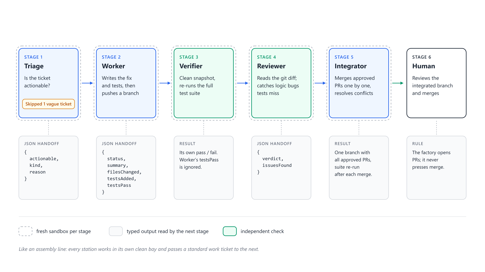
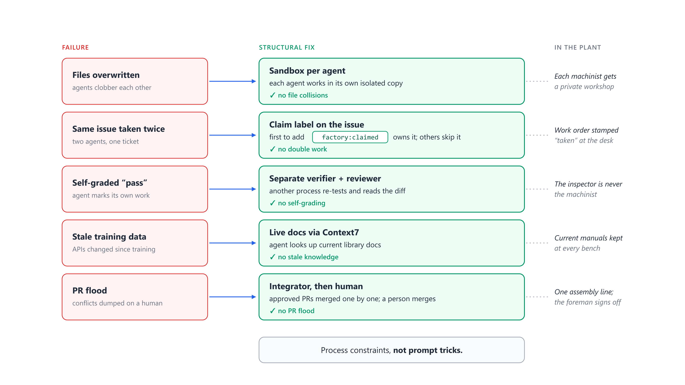

# Lab 3: Anatomy of a run

**Goal:** run the full line with zero-cost stand-in agents and follow one issue through every stage, handoff and file the factory writes.



## 1. Plan, then run

```bash
cd ~/factory-lab
node "$SF" plan
node "$SF" run --yes --concurrency 5
```

`plan` starts nothing: it lists the queue, what is already claimed, and the **budget ceiling** (the maximum the run may spend, not an estimate). `run` asks for confirmation unless you pass `--yes`.

Watch the log. Each line is `<seconds> #<issue> <stage>: <result>`. Lanes interleave, because issues move independently: #4 can be in review while #9 is still in triage.

## 2. The report

At the end the runner prints a table (also saved as `report.md`). Expect 9 `ready_for_human`, issue #10 `triaged_out`, and an integration section.

## 3. Follow issue #3 through the ledger

```bash
RUN=$(ls .factory/runs | tail -1); cd .factory/runs/$RUN
ls
grep '"issue":3' events.jsonl
ls traces | grep 'issue-3\.'
cat prs/issue-3.md
```

| File | What it tells you |
|---|---|
| `events.jsonl` | the order of events: `claimed`, `stage_start`/`stage_end` for triage, worker, reviewer, then `outcome` |
| `run.json` | the outcome object for #3: `triage`, `work`, `verifier`, `review`, `seconds`, `costUsd`, `branch`, `pr` |
| `traces/issue-3.<stage>.prompt.md` | exactly what each stage was asked |
| `traces/issue-3.<stage>.result.json` | the typed handoff it returned |
| `prs/issue-3.md` | the pull request body: a table of every gate's result |
| `snapshot/` | the clone of `main` (plus `setup`) that every sandbox was copied from. The per-stage copies lived in `boxes/` and were deleted after each stage (`--keep-sandboxes` keeps them) |

Note what is **not** in the traces: no verifier agent. The verifier is runner code (`pipeline.mjs`, step 3) that ran `npm test` on a fresh copy. There is nothing to persuade.

## 4. Map the five fixes to the code

Open `skills/software-factory/scripts/lib/pipeline.mjs` and find each fix:

| Fix | Look for |
|---|---|
| Sandbox per stage | `boxes.create(\`issue-${issue.id}-triage\`)`, `-worker`, `-verify`; `destroy()` after each |
| Claim before work | `claims.claim(issue, ...)` in `runFactory` |
| Independent verifier | `verifier.checkout(branch)` then `verifier.test()`, with one retry |
| Reviewer that cannot write | `before = await verifier.status()` ... `if ((await verifier.status()) !== before)` |
| Integrator, then a human | `integrate()`; and the absence of any merge into `baseBranch` anywhere |



## 5. Score the fake work against the hidden tests

```bash
cd ~/factory-lab
node ~/software-factory-from-scratch/codelab/scripts/score.mjs shortlinks.git --integration factory/integration
```

All nine fail: the fake worker changes nothing real, and the fake reviewer approves everything. **Every gate was green and nothing works.** Keep this in mind for Lab 7: a factory is only as good as what its gates actually check.

## Checkpoint

- 9 ready, 1 triaged out, integration finished with the tests passing.
- You can point to the line of code behind each of the five fixes.

## Questions

1. Which stages are agents and which are code? Why is that split important?
2. Why does the runner, not the worker, run `git commit` and `git push`?
3. The fake run "passed" everything yet scores 0/9. Which gate would have caught it with a real reviewer, and which only with better tests?

Leave the claims in place: Lab 4 starts by looking at them.
