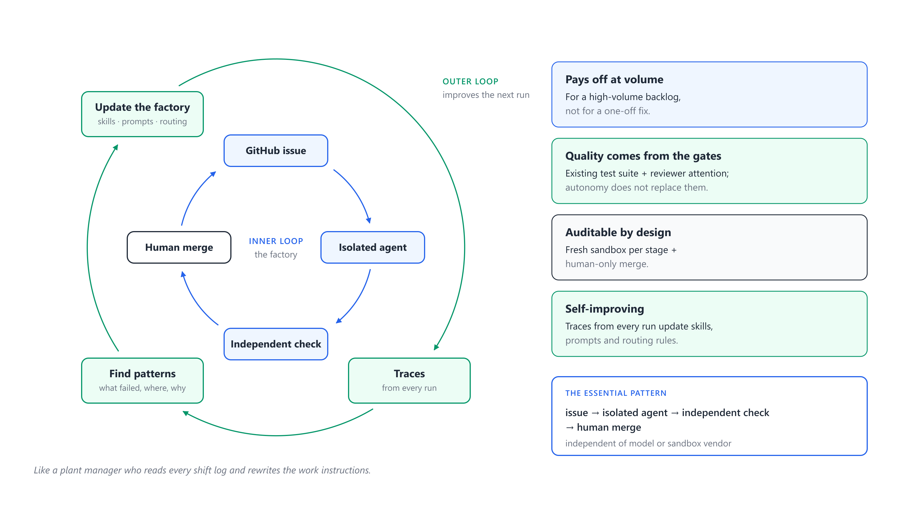

# Lab 11: The outer loop (capstone)

**Goal:** make the factory better using only evidence from its own traces, the way a plant manager reads every shift log and rewrites the work instructions, and prove the change helped.



## 1. A real example from building this repository

The first full real run of this factory, on Windows, produced this in four of nine worker traces (`traces/issue-3.worker.output.json`, field `permission_denials`):

```text
Bash: sed -i 's|    const link = ctx.store.get(stats\[1\]);|&\n    if (!link) return send(res, 404, ...)|' src/app.js
      cat > test/stats.test.js <<'E' ... E
      npm test 2>&1 | tail -15
PowerShell: npm test 2>&1 | Select-Object -Last 15
```

and the worker's handoff:

```json
{ "status": "blocked", "testsPass": false,
  "blockedReason": "Shell tools (Bash/PowerShell) were denied by the permission mode (don't ask), so npm test could not be run..." }
```

The fix itself was correct. Two things went wrong:

1. The worker chained `sed`, a heredoc and `npm test | tail` into one shell call. Claude Code allows a compound command only if **every** part matches an allowed rule, and `sed`, `cat` and `tail` were not allowed. On Windows it then tried the PowerShell tool, which had no rules at all.
2. It reported `blocked`, a word meant for "the issue cannot be built as written", for a tooling problem.

The improvement, with the evidence, became three small changes (see the repository history):

| Change | Where |
|---|---|
| Shell rules for both shells, bare and with arguments: `Bash(npm)`, `Bash(npm *)`, `PowerShell(npm)`, `PowerShell(npm *)` | `DEFAULTS.tools` in `lib/config.mjs` |
| Worker rule: edit files with Edit/Write; one plain command per call; tool denial is not `blocked` | `factory-worker/SKILL.md` rules 8 and 9 |
| Every task prompt lists the allowed shell prefixes | `shellPrefixes()` in `lib/prompts.mjs` |

Metric: worker permission denials and `blocked` outcomes. The re-run (Lab 6 numbers) had none. No gate was loosened: nothing in the change lets an agent do more than run the same commands it was always meant to run.

## 2. Your turn: collect evidence

Use the runs made with **real** agents. The fake dry runs from Labs 2 to 5 would distort every signal, so filter them out with `--agent claude`. Your runs live in two places: `~/factory-lab` (Labs 6 to 9) and `~/shortlinks-factory` (Lab 10).

```bash
cd ~/factory-lab        && node "$SF" stats --agent claude
cd ~/shortlinks-factory && node "$SF" stats --agent claude     # if you did Lab 10
```

Then open Claude Code in `~/factory-lab` and invoke the outer-loop skill:

```
/factory-improve   Use only real-agent runs (stats --agent claude). Also consider the runs in ~/shortlinks-factory.
```

It runs `stats` itself, opens the ledgers and traces behind anything interesting, finds **patterns** (not single events), and proposes small diffs to stage skills or the config, each with the evidence, the expected effect and the metric to watch. Its contract forbids lowering a gate.

Where to look if you want to find patterns yourself:

| Signal in `stats` | Typical root cause |
|---|---|
| `rejectedBy.reviewer` with similar `issuesFound` | workers do not test a class of edge case: teach the worker |
| `selfReportMismatch` | the worker's local run differs from a clean run: environment or rule |
| `conflictHotspots` | lanes write the same file: per-issue test files, or split the file |
| `deniedTools` | a stage needs a narrow extra rule, or behaves badly with the shell |
| `triagedOut` that a human would accept | triage criteria too strict |
| hidden-test failures on approved branches | the reviewer missed it: extend reviewer step 4 |

## 3. Apply one improvement and measure it

1. Pick **one** proposal. Apply it on a branch of your fork of the skills repository; put the evidence in the commit message.
2. Release the affected issues, run again with the same settings, score with the hidden tests.
3. Fill in:

| Metric | Before | After |
|---|---|---|
| The metric your change targets | | |
| Hidden tests passed (score.mjs) | | |
| Model cost for the same issues | | |
| Any gate loosened? | no | no |

4. Write a five-line entry in an `IMPROVEMENTS.md`: date, change, evidence (run ids), result, decision (keep or revert).

## Capstone deliverable

A short report (one page) containing:

1. Your measured run table from Lab 6, with the video's numbers next to it (10 issues, 4 min 34 s, 9 PRs, 9/9 hidden tests, 7/9 conflicts, $3.67 + $6.37).
2. One failure you observed in your own traces, with the evidence quoted.
3. The improvement you made, the before/after table, and your decision.
4. One paragraph: for which kinds of backlog would you, and would you not, use a software factory? Use your cost and integration numbers.

## Questions

1. Why must a human approve changes to the factory, even when the outer loop finds them automatically?
2. Name a change that would raise the pass rate while making the factory worse. How does the `factory-improve` skill guard against it?
3. Some improvements are routing rules, not prompts (which model, whether to ground, how many lanes). Propose one routing rule for this repository, with the evidence that justifies it.
