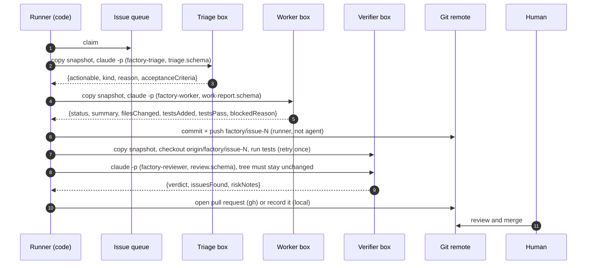

# Architecture

This document explains how the factory is built and why. For the settings, see [configuration.md](configuration.md); for the threat model, [security-model.md](security-model.md).

## The one idea

> **issue -> isolated agent -> independent check -> human merge**

Everything else exists to keep that loop correct when many issues run at once. The video calls the additions "process constraints, not prompt tricks": each one removes a failure mode structurally, so the factory does not depend on an agent behaving well.

| Failure when agents run in parallel | Structural fix | Where |
|---|---|---|
| Agents overwrite each other's files | One sandbox per stage, booted from one snapshot | `lib/sandbox.mjs` |
| Two agents take the same issue | Claim before work (label or atomic directory) | `lib/issues.mjs` |
| An agent says "tests passed" when they do not | Verifier is code, on a fresh copy of the pushed branch; reviewer is a different agent | `lib/pipeline.mjs` |
| Agents use stale APIs | Live docs through a key-holding proxy | `lib/docs-proxy.mjs`, `factory-live-docs` |
| A flood of conflicting PRs | Integrator merges approved branches one at a time; a human merges PRs | `integrate()` in `lib/pipeline.mjs` |

## Skills as the unit of design

The repository is a set of Claude Code skills. Each one is useful on its own to a human in Claude Code, and the stage skills are also **the contract** the runner gives each stage agent:

```
skills/
  software-factory/        workflow skill (human-triggered) + the runner + the schemas
    SKILL.md               procedure: config -> doctor -> plan -> go-ahead -> run -> report
    scripts/factory.mjs    CLI: init, doctor, plan, run, integrate, report, stats, release
    scripts/lib/*.mjs      config, issues+claims, sandbox, agent, prompts, pipeline, ledger, docs proxy, schema, proc
    schemas/*.schema.json  triage, work-report, review, integration
  factory-triage/          stage contract (agent)
  factory-worker/          stage contract (agent)
  factory-verifier/        gate documentation + scripts/verify-branch.mjs (the gate itself is runner code)
  factory-reviewer/        stage contract (agent)
  factory-integrator/      stage contract (agent)
  factory-claims/          how claiming works; inspecting and releasing claims
  factory-sandbox/         isolation model; backend guides (Upstash Box, containers)
  factory-live-docs/       grounding; scripts/docs.mjs
  factory-report/          reading ledgers; reporting to humans
  factory-improve/         the outer loop
```

**Why skills plus a runner, and not an agent orchestrating agents?** The control flow (claim, then triage, then build, then verify, retry once, then review, then PR, never merge) must hold every time. Code holds it every time; a prompt holds it most of the time. So the orchestration is a small deterministic program, and agents are used only where judgment is needed: deciding if an issue is clear, writing the change, reviewing it, resolving a conflict. The workflow skill wraps the program in a human procedure: preflight, an explicit go-ahead with a budget ceiling, and a report that ends at the human merge.

## One issue through the line



Each box is created for one stage and deleted after it. Stages share nothing except the git remote and the typed handoffs.

### Outcomes

| Stage reached | `outcome.stage` |
|---|---|
| triage says not actionable | `triaged_out` |
| worker says blocked | `blocked` |
| worker changed nothing | `no_changes` |
| worker deleted a protected (test) file | `rejected` (`rejectedBy: guard`) |
| tests fail twice on a clean copy | `rejected` (`rejectedBy: verifier`) |
| reviewer changed the working tree | `rejected` (`rejectedBy: guard`) |
| reviewer requests changes | `rejected` (`rejectedBy: reviewer`) |
| everything passed | `ready_for_human` |
| a stage crashed, timed out or broke its schema | `error` |

## Stage agents

Each stage agent is one headless Claude Code process, started by `runStage()` in `lib/agent.mjs`:

```
claude -p
  --output-format json
  --json-schema <stage schema>              typed handoff, enforced at generation time
  --model <model>
  --max-budget-usd <budgets.stage>          hard spend ceiling per invocation
  --permission-mode dontAsk                 anything not allowed is denied, never prompted
  --allowedTools <tools.stage>              e.g. Read, Edit, Write, Glob, Grep, Bash(npm *), ...
  --append-system-prompt-file <contract>    the stage skill body (+ live-docs section when grounded)
  --no-session-persistence
  --setting-sources project --strict-mcp-config    (isolateAgentConfig) no personal hooks, plugins or MCP
  < task prompt on stdin
  cwd = the stage's sandbox
  env = runner env minus secretEnv
```

The runner then validates `structured_output` against the same schema (`assertValid`). Two layers: the model is constrained when it writes, and the boundary checks again before anything downstream reads it.

**Task vs contract.** The task prompt (`lib/prompts.mjs`) says what to work on this time: the issue, acceptance criteria, the test command, the allowed shell prefixes. The contract (the stage skill) says how to behave every time. Keeping them apart means improving a stage is a reviewable edit to one Markdown file.

## The verifier is code

An agent asked "did the tests pass?" can be wrong, can be persuaded, and costs money. A program that runs the configured test command on a fresh copy of the pushed branch cannot be talked into anything. That is why the verifier has no agent, no prompt and no schema: it is about 20 lines in `handleIssue()`. It also re-runs `setup` when the branch changed a dependency manifest, and retries once to separate flaky tests from broken ones. When the worker's self-report disagrees with the verifier, the ledger records `selfReportMismatch: true` for the outer loop.

## The reviewer looks for what tests miss

By the time the reviewer runs, the tests already pass. Its contract (`factory-reviewer/SKILL.md`) lists what tests typically miss, including ordering and ties, which the video's rehearsal run caught: links created in the same millisecond came back in alphabetical order instead of creation order, and every test passed because the test data happened to be sorted. The codelab's issue #8 and hidden test `h08` reproduce that trap. The reviewer may run tests and read-only experiments, has no write tools, and the runner discards a review if the working tree changed during it.

## Integration

Branches that pass individually still conflict together: they start from the same snapshot and touch the same places, very often one shared test file. The video measured 7 of 9 conflicting. `integrate()`:

1. creates a fresh box and checks out `integrate.into` from the base branch,
2. merges each ready branch in issue order with `--no-ff`,
3. on conflict, runs the integrator agent (keep both sides, never drop tests, stage files, do not commit),
4. checks that no unmerged paths and no conflict markers remain, commits, and runs the tests,
5. pushes after every successful merge, so a failure never loses progress, and stops at the first failure.

The base branch is never written. The config refuses `integrate.into == baseBranch`.

## Ledger and outer loop

Every run writes `.factory/runs/<run-id>/`: `run.json` (outcomes, costs, timings), `events.jsonl`, `traces/` (prompt, contract and raw output of every agent call), `prs/`, `report.md`, and `docs-queries.log` when grounded. `factory.mjs stats` aggregates all runs into the signals the `factory-improve` skill mines: rejections by gate, self-report mismatches, reviewer findings, triage rejections, denied tools, conflict hotspots and costs. Improvements are proposed as diffs to stage skills or config, approved by a human, and measured on the next run.

## Extending

- **New stage** (for example a security scanner after the reviewer): a skill with an "Output contract", a schema, an entry in `STAGE_SKILL`/`STAGE_SCHEMA` in `agent.mjs`, a prompt in `prompts.mjs`, a budget/timeout/tools entry in `config.mjs`, and a call in `handleIssue()`.
- **New sandbox backend:** implement the interface described in `factory-sandbox/SKILL.md`; guides for Upstash Box and containers are in `factory-sandbox/references/`.
- **New issue source** (Jira, Linear): implement `loadIssues()` and a claim store for it in `issues.mjs`.
- **Other languages:** nothing in the runner is Node-specific except the defaults. Set `setup`, `test`, `tools` and `protectedPaths` for your stack (for example `pytest`, `Bash(pytest *)`, `Bash(uv *)`).
